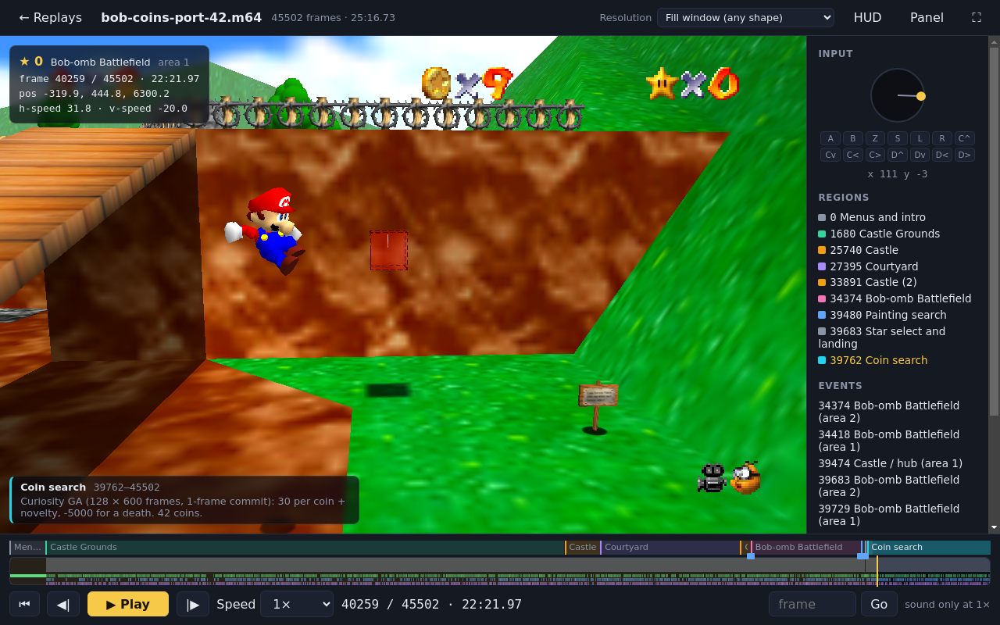
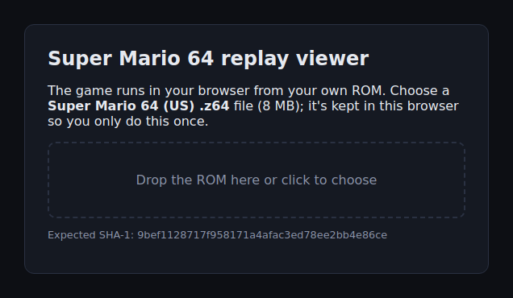
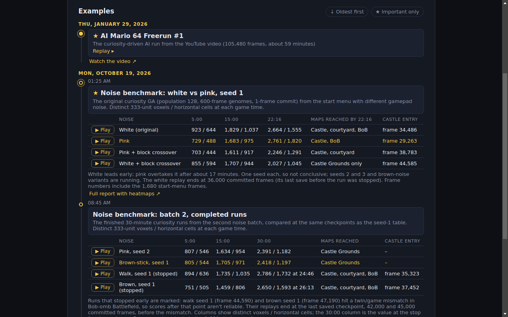

# SM64 Replay Viewer

Watch Super Mario 64 input replays in your browser, played by the real game
rather than a recording.

**Open it: <https://gumbo64.github.io/sm64-viewer/>**

The start page has runs from the
[sm64-AI-binds](https://github.com/Gumbo64/sm64-AI-binds) experiments, AI
searches that learn to play the game, in date order with their results. You
can also open your own replay files.

## You need a ROM

The viewer runs the game itself, so the first time you open it, it asks for a
**US Super Mario 64 ROM** (`.z64`). The ROM stays in your browser: it's
stored locally (IndexedDB) so you're only asked once, and it's never
uploaded. The site doesn't provide one. The right file has SHA-1
`9bef1128717f958171a4afac3ed78ee2bb4e86ce`.

## Watching a replay

- **Pick a run** from the start page. Runs in a results table play from their
  ▶ Play button.
- **Open your own file** by dropping it on the page, or paste a link to one.
  Both kinds of input file work: the raw files sm64-AI-binds writes (4 bytes
  per frame) and Mupen64 `.m64` movies, such as TASVideos submissions.
- **Share a moment** with a link like
  `https://gumbo64.github.io/sm64-viewer/?m64=<link to the file>&start=<frame>`,
  which opens the replay at that frame.

While it plays:

- **Timeline**: click anywhere to jump there. The strip shows the stick (grey)
  and A, B and Z presses (green, blue, purple).
- **Coloured bands above the timeline** mark what the run is doing at each point:
  which part of the game it's in, or which phase of the algorithm is in
  control (for example a scripted route handing over to a coin search). The
  current one is named in the bottom-left of the picture and listed in the
  side panel. Click one to jump to its start.
- **HUD**: frame, time, stars, course, Mario's position and speed.
- **Side panel**: the controller input, the regions, and the stars and
  course changes so far, each clickable.
- **Speed**: 0.25× to 16×, or as fast as your computer can go. Sound plays at
  1× only.
- **Going backwards** reloads the page and fast-forwards to the frame you
  asked for, because the game can only run forwards. Long jumps back into a
  long run take a moment.

| Key | Action |
|---|---|
| Space / k | play / pause |
| → / . | next frame |
| ← / , | previous frame (reloads) |
| Shift + ← / → | back / forward 10 seconds |
| + / − (or ] / [) | speed |
| Home / End | start / end |
| f · h · p | fullscreen · HUD · side panel |

It needs a desktop browser with WebGL. Large runs use a lot of memory (the
game alone takes about 640 MB).

## Saving a video

**Export MP4** (top right) saves any part of a replay as a video file, with the
annotations drawn in, ready to upload to YouTube:

- **Choose what to include**: tick any of the run's regions and add your own
  frame ranges. They're joined in order and the gaps are skipped, so you can
  cut a long run down to its highlights.
- **Choose the look**: 1080p or 720p, wide or the game's 4:3 shape; the
  current region's name and note, a bar of the regions along the bottom, a
  small HUD with the course and frame, the controller input (stick and
  buttons), and the game's sound.
- Every frame is in the video, with the sound that goes with it. Exporting
  usually runs faster than watching.

It works best in Chrome or Edge, which save straight to a file of any length
and use H.264 where the computer supports it. Other browsers build the video
in memory, so keep exports there short.

## Developing

Building it, adding runs to the start page (`index.json`, including region
annotations) and the tests are in [frontend/README.md](frontend/README.md).
